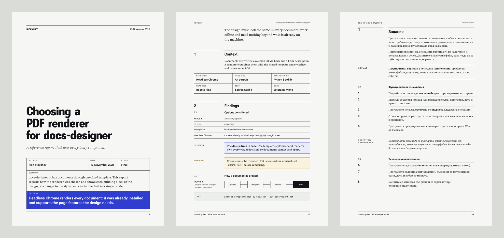
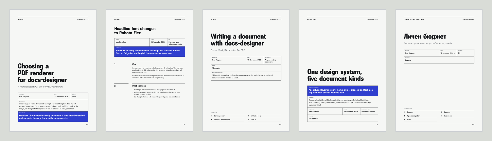
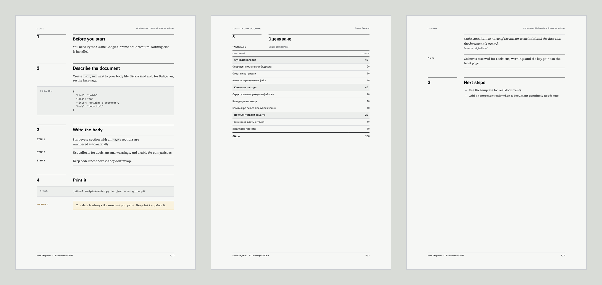
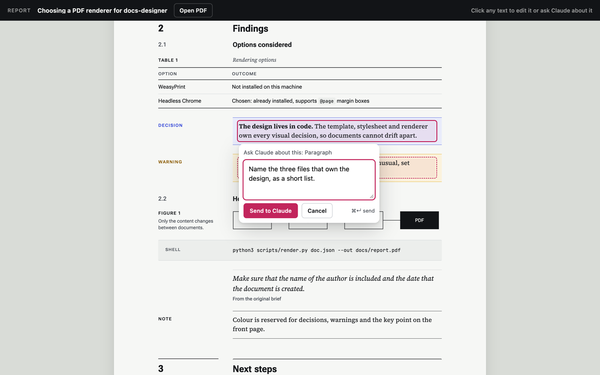
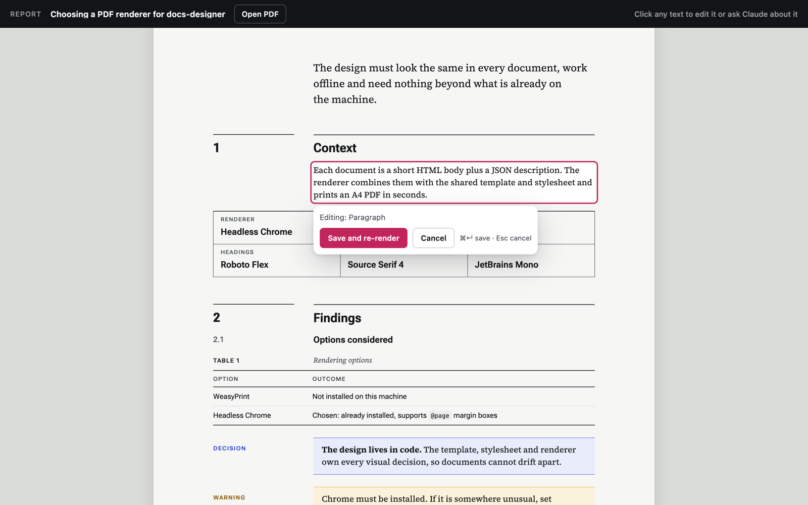
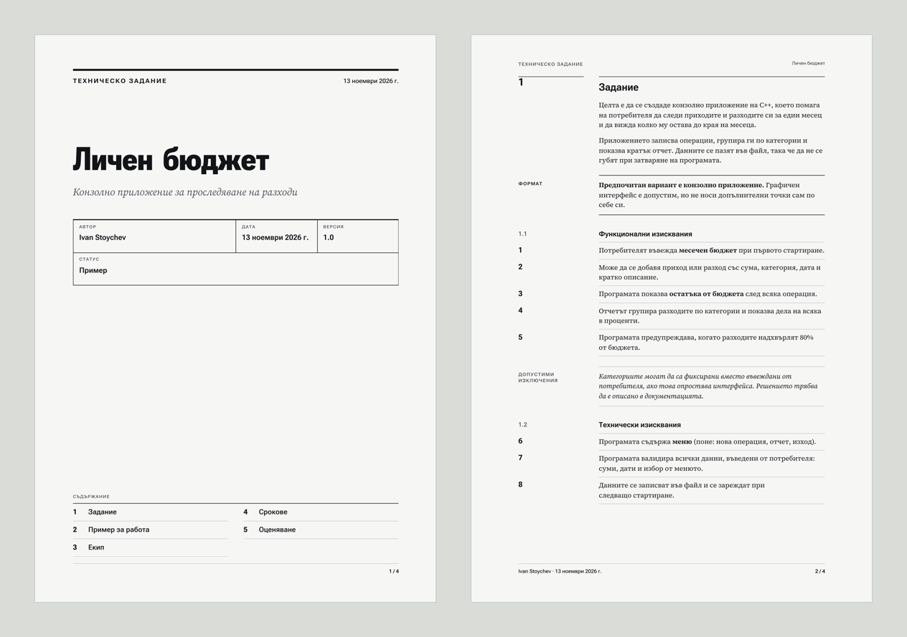

<div align="center">

# docs-designer

**Turn any Claude conversation into a beautifully designed PDF. Then click any word to change it.**

Reports, memos, guides, proposals and technical requirements, all in one consistent design language, in English or Bulgarian, with your name and the date on every page.

[](LICENSE)
[](https://github.com/iystoychev/docs-designer/releases)
[](#install)
[](#requirements)



</div>

## Why

You just spent an hour with Claude working something out: a design decision, a project plan, an assignment brief. The result is scattered across forty messages. Copy-pasting it into a doc loses the structure, and exporting the chat looks like an exported chat.

**docs-designer** asks Claude to do the editorial work (pick what matters, lead with the outcome, never invent anything) and hands the design to code: one template, one stylesheet, one renderer. Every document comes out looking deliberately made, and every document looks like it belongs to the same family.

## Features

- **One sentence to a finished PDF.** "Turn this conversation into a report." Claude distills the chat, picks the right document kind and prints an A4 PDF.
- **Five document kinds, one design system.** Report, memo, guide, proposal and technical requirements, each with a front page shaped for its job.
- **Author and date, always.** Your name (from `git config user.name`, or any name you give) and the creation date go on the front page and in the footer of every page.
- **Click-to-edit inspector.** Open the document beside the chat, click any text, fix it in place and the PDF re-renders.
- **Point and ask.** Click a paragraph, type "make this shorter", and Claude receives an instruction that references that exact element.
- **English and Bulgarian.** Labels, dates and fonts switch with one field; every font covers Latin and Cyrillic.
- **Works offline, installs nothing.** Python 3 standard library plus the Chrome you already have; fonts are bundled.
- **No AI fingerprints.** Documents never mention Claude, the chat or the session. They read as your own work.

## Five kinds, one family



| Kind | Use it for | Front page |
|---|---|---|
| `report` | findings, technical summaries, recaps, decision records | full cover: title over the summary and the key point |
| `memo` | a short decision or announcement | no cover: a compact head, body on page one |
| `guide` | how-tos, onboarding, step-by-step instructions | cover with a contents map |
| `proposal` | a plan someone has to approve | cover that leads with the recommendation |
| `requirements` | specs, assignment briefs, acceptance criteria | cover with a contents map; requirements numbered across the document |

Inside, every kind shares the same components: numbered sections, decision and warning callouts, key facts, steps, code blocks that keep their indentation, tables with group rows and totals, quotes and figures.



## The inspector: click, edit, ask

Every rendered document gets a card right in the chat, under the step that made it. **Inspect and edit** on the card opens that document in the app's browser with the real fonts and layout:

- **Hover** outlines anything you can change.
- **Edit text** lets you type straight into the page. Save with ⌘↵: the change is written back to the document's source and the PDF re-renders in a second or two.
- **Ask Claude…** sends an instruction about that element. Claude receives the element, its section, its current text and its file, applies the change and re-renders.
- The page **reloads by itself** whenever the document changes, including when Claude edits it.

| Point at a paragraph and ask Claude | Edit any text in place |
|---|---|
|  |  |

## Bulgarian out of the box

Set `"lang": "bg"` and labels, dates ("13 ноември 2026 г.") and headings switch to Bulgarian. Requirements keep their numbering across groups, and exceptions get their own italic callouts.



## Install

docs-designer is a Claude Code plugin: the skill and the inspector install together.

At the prompt of a Claude Code terminal session:

```
/plugin install docs-designer --marketplace iystoychev/docs-designer
```

Answer `y` to add the marketplace, then pick a scope (user scope makes it available everywhere). From a shell instead:

```bash
claude plugin install docs-designer --marketplace iystoychev/docs-designer
```

In the Claude desktop app, click **+** next to the prompt box, then **Plugins**, **Add marketplace** with `iystoychev/docs-designer`, then **Add plugin**.

<details>
<summary>Just the skill, without the inspector</summary>

```bash
git clone https://github.com/iystoychev/docs-designer.git
ln -s "$PWD/docs-designer/skills/docs-designer" ~/.claude/skills/docs-designer
```

</details>

### Requirements

- Claude Code (terminal or desktop app)
- Python 3.10 or newer (standard library only)
- Google Chrome or Chromium (set `CHROME_PATH` if it isn't in the usual place)
- macOS or Linux

## Use it

Ask in plain words, at the end of any conversation:

```
Turn this conversation into a report.
Write up what we decided as a memo for the team.
Make a guide from the steps we just worked out.
Turn these notes into a technical requirements document in Bulgarian.
Write this up as a proposal; the author is Jane Doe.
```

Claude writes two small files and renders them. You can do the same by hand:

```json
{
  "kind": "proposal",
  "lang": "en",
  "title": "One design system, five document kinds",
  "abstract": "Documents of different kinds need different front pages, but should still look like one family.",
  "outcome": "Adopt typed layouts, chosen with one field.",
  "meta": { "Prepared for": "Document authors", "Status": "For approval" },
  "body": "body.html"
}
```

```bash
python3 skills/docs-designer/scripts/render.py doc.json --out proposal.pdf
```

The body is a small HTML fragment that uses a fixed vocabulary (sections, callouts, steps, key facts, tables, figures), so the design can never drift. See [`SKILL.md`](skills/docs-designer/SKILL.md) for the full vocabulary and [`examples/`](skills/docs-designer/examples) for one complete document of each kind.

Commands:

- `/docs-inspect` opens the inspector for the latest document.
- `python3 skills/docs-designer/scripts/inspect_server.py` runs the inspector on its own, at `127.0.0.1:8765`.
- `python3 skills/docs-designer/scripts/extract_session.py --list` lists your past Claude Code sessions to document.

## How it works

```
conversation ──► Claude distills ──► doc.json + body.html ──► render.py ──► A4 PDF
                                              ▲                    │
                     inspector edits ─────────┘                    └──► ~/.docs-designer/last.json
                     "Ask Claude" ──► prompt with the element ──► Claude edits the source
```

- **`render.py`** fills the template with your content, then prints it with headless Chrome. The author is resolved from the spec, `--author` or git; the date is always the moment of rendering.
- **`style.css`** is the whole design system: a 34 mm margin rail for labels, a 118 mm reading measure, Roboto Flex on its width axis for headings, Source Serif 4 for text and JetBrains Mono for code. Colour is rationed: cobalt only for decisions, amber only for warnings.
- **The inspector** serves the same page with every editable element tagged, writes edits back to the source and re-renders. The plugin runs it, puts the document card in the chat and turns "Ask Claude" into a prompt.

The design decisions are recorded in [`DESIGN.md`](DESIGN.md) and [`PRODUCT.md`](PRODUCT.md).

## Limits

- The inspector shows the document as a web page in the real design, not split into PDF pages. Use **Open PDF** to check page breaks.
- Labels and dates come in English and Bulgarian. Adding a language is a small table in `render.py` plus a few lines of CSS.
- Windows isn't tested.

## Contributing

Issues and pull requests are welcome. Keep the design in code: a new component goes into `style.css` and the vocabulary in `SKILL.md`, and every example in `skills/docs-designer/examples/` should still render.

```bash
for k in report memo guide proposal requirements; do
  python3 skills/docs-designer/scripts/render.py skills/docs-designer/examples/$k/doc.json --out /tmp/$k.pdf
done
```

## License

[MIT](LICENSE) © Ivan Stoychev. The bundled fonts (Roboto Flex, Source Serif 4, JetBrains Mono) are under the [SIL Open Font License 1.1](skills/docs-designer/assets/fonts/OFL.txt).
